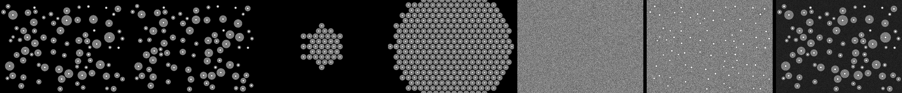

# 随机微透镜阵列 SLM 实验 · 2026-11-23

用一台纯相位液晶空间光调制器（DHC GCI-770202，1024×768 / 18 µm）显示**随机微透镜阵列**的相位图——每枚透镜的位置和焦距都随机，焦距 3–5 cm——并在真实光路里记录它产生的光场。

本仓库是 **2026-11-23 当天**的实验记录与原始数据：过程、设计约束、七种图案、十四组原始帧、轴向扫描与定量对比。

> 驱动与生成工具链在另一个仓库：[**slm-lab**](https://github.com/summit-leen/slm-lab)
> （`code/random_lens_array.py`、`code/dense_mla.py`、`code/random_phase.py`、`code/cam_stack.py` 等；本仓库只放当天的数据与记录，不重复代码。）



从左到右：随机透镜阵列 f 30–50 mm、f 39.4–40.6 mm、密排 39 枚、密排铺满 355 枚、随机相位、混合（全幅随机背景）、混合（弱随机背景）。

## 结论速览

| 项 | 结果 |
| --- | --- |
| 透镜口径 | 0.35–1.56 mm（受采样极限 r ≤ λf/2p 限制） |
| 最大 NA | 0.017（被 18 µm 像素间距钉死） |
| 焦斑 FWHM | 38–42 µm（衍射极限 22 µm 的 1.7 倍） |
| 景深 | ≈ 4 mm（λ/NA²） |
| 最佳焦面 | 51.5–52.4 mm（设计值 50 mm，后移 1.5–2.4 mm） |
| 散斑对比度 | σ/μ = 0.140（无检偏器，80% 直穿光当底噪） |
| 散斑颗粒 | 14 µm |
| 焦点峰/底 | ≈ 2.0 |
| 三种图案平均亮度 | 13.08 / 13.08 / 13.12 —— 相位调制只重排光，不改变总能量 |

## 仓库结构

```
├── README.md
├── docs/
│   └── experiment-log.md        完整过程：物理约束、七种图案、结果、踩坑、结论
├── patterns/                    7 个图案（npy 为送 SLM 的精确 8-bit 数组 + png）
├── data/                        14 组原始帧 + PSF 轴向扫描
│   ├── <名称>_first.npy         第一帧原图 uint8 (2178×3860)，未处理
│   ├── <名称>_first.png         原图转 PNG，未拉伸
│   ├── <名称>_mean_f16.npy      多帧平均 float16（原始 float32 为控体积转存）
│   ├── <名称>_mean_view.png     平均图的分位拉伸可视化（仅供看）
│   └── psf_ax/                  9 个焦面（3 ms 曝光第一帧）+ meta.json
└── figures/                     9 张关键分析图
```

## 采集一览

| 名称 | 曝光 | 帧数 | 图案 | 说明 |
| --- | --- | --- | --- | --- |
| `x200_on` | 10 ms | 16 | f39.4–40.6 | L=200 mm 几何第一组 |
| `x200_off` | 10 ms | 12 | — | **作废**：黑屏脚本数组转置报错，实际仍是阵列 |
| `y200_on` | 10 ms | 16 | f39.4–40.6 | 正确重拍 |
| `y200_off` | 10 ms | 12 | 全黑 | 真正的未调制参考 |
| `spk1` / `spk50` | 10 / 50 ms | 16 / 12 | 随机相位 | 散斑 |
| `dma_cluster` | 20 ms | 16 | 密排 39 枚 | 6.2 mm 簇 |
| `dma_off` | 20 ms | 12 | 全黑 | 同几何未调制参考 |
| `dma_full18b` | 20 ms | 16 | 密排 355 枚 | 铺满 18 mm |
| `dma_full_spk` | 50 ms | 12 | 密排 355 枚 | 长曝光版 |
| `spk_full` | 50 ms | 12 | 随机相位 | σ/μ 0.140，颗粒 14 µm |
| `rla_full` | 50 ms | 12 | f 30–50 随机阵列 | 稀疏焦斑，max 55.3 |
| `hyb_full` | 50 ms | 12 | 阵列 + 全幅随机背景 | 散斑底 + 焦斑 |
| `hybA_full` | 50 ms | 12 | 阵列 + 弱随机背景(0–64) | 背景 σ/μ 降到 0.109 |

## 复现

```bash
git clone https://github.com/summit-leen/slm-lab.git
cd slm-lab
# 生成 01 号图案并显示
python code/random_lens_array.py --n 80 --seed 20261123 --show --hold 0
# 生成 05 号随机相位
python code/random_phase.py --seed 7 --block 1 --show --hold 0
# 采集 12 帧并平均
python code/cam_stack.py --exp 50000 --n 12 --out captures/test
```

面板拓扑：SLM 作为第二块显示器，1024×768 @ 100%，位于主屏右侧；`slm_driver.py` 负责无边框全屏显示与帧泵。

## 注意事项

- `*_mean_view.png` 经过分位拉伸，**只用于看**；定量分析请用 `.npy`。
- 场景本身很暗（mean 5–13 / 255）：无检偏器 + 光被摊到 7.72 mm 靶面 + 50 ms 曝光，不是数据错误。
- `x200_off` 与 `dma_full18`（未收录）是两次无效采集，原因见实验记录的 §7。
